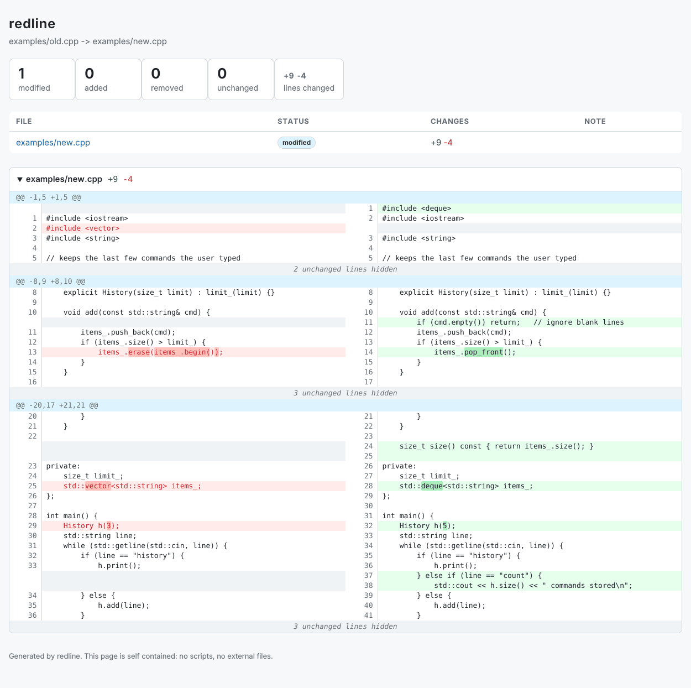
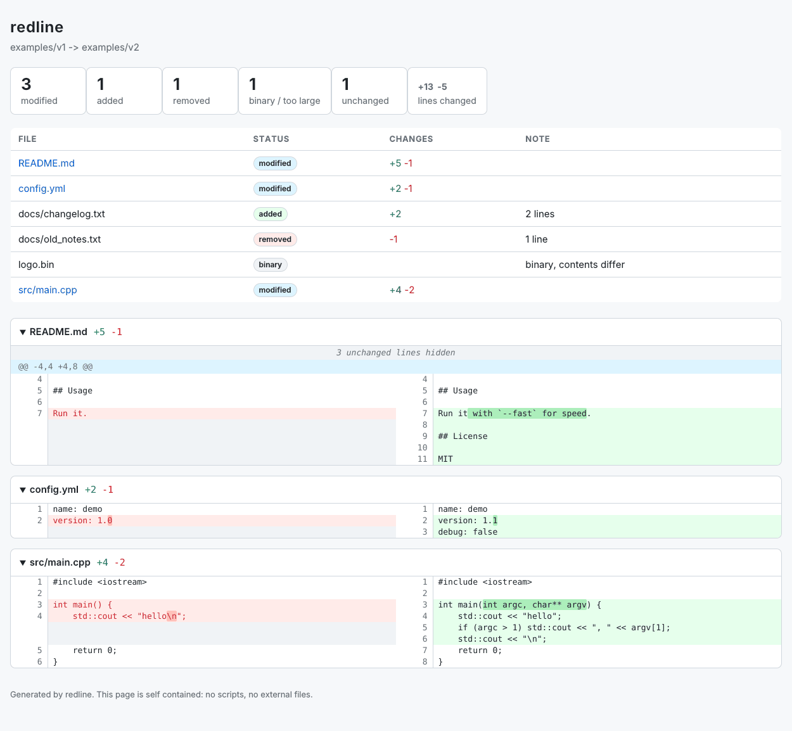

# redline

A small diff tool in C++17, with Python tools that check it.

It compares two files or two folders, prints a unified diff (the same format as `diff -u` and
`git diff`), and can also write a side by side HTML report with the changed words highlighted.

Diff tools look simple from the outside, but there is a real algorithm inside: given two lists
of lines, find the smallest set of insertions and deletions that turns one into the other.
I wanted to build that part myself and then wrap it in something useful, so redline has the
algorithm (Myers' O(ND) diff), a folder comparison, and a report you can open in a browser.

## Screenshots

These are previews of the generated HTML reports (examples are in `examples/`).




The previews were rendered with `wkhtmltoimage`, an old WebKit, so fonts differ a little from what
Chrome or Firefox will show. The report itself is a single HTML file with inline CSS, no
JavaScript and no external files, and it follows the system dark/light setting.

## Build and run

You need a C++17 compiler with `<filesystem>` (developed with g++ 13), `make`, and Python 3.7 or newer for the checking tools.

```
make              # builds build/redline and build/redline_tests
make test         # C++ unit tests
make check        # compare redline with an independent Python implementation on random inputs
make sanitize     # unit tests under AddressSanitizer and UBSan
make demo         # runs both example comparisons and writes reports into build/
```

```
./build/redline examples/old.cpp examples/new.cpp --html report.html
./build/redline examples/v1 examples/v2 --html folders.html
./build/redline a.txt b.txt --context 5 --ignore-space --color
```

| option | meaning |
|---|---|
| `--html FILE` | also write a side by side HTML report |
| `--context N` | unchanged lines around each change (default 3) |
| `--full` | show the whole files in the HTML report |
| `--ignore-space` | ignore differences in spaces and tabs |
| `--color` | colour the terminal output |
| `--ignore a,b` | folders only: skip files or folders with these names (default `.git`) |
| `--max-edits N` | stop looking for the perfect diff after N changed lines (default 4000, max 10000) |

Exit codes follow GNU diff so it works in scripts: 0 means no differences, 1 means differences,
2 means an error.

Example (`examples/old.cpp` against `examples/new.cpp`, first hunk):

```
--- examples/old.cpp
+++ examples/new.cpp
@@ -1,5 +1,5 @@
+#include <deque>
 #include <iostream>
-#include <vector>
 #include <string>
```

For folders it prints one line per difference and a summary:

```
modified: README.md (+5 -1)
modified: config.yml (+2 -1)
added: docs/changelog.txt (2 lines)
removed: docs/old_notes.txt (1 line)
binary: logo.bin (binary, contents differ)
modified: src/main.cpp (+4 -2)
summary: 1 added, 1 removed, 3 modified, 1 binary, 1 unchanged
```

## How it works

**1. Lines become numbers.** Every distinct line is stored once in a hash map and replaced by a
small integer. After that, comparing two lines is comparing two ints, no matter how long the line is.

**2. The common start and end are cut off.** If two files share their first 5,000 lines and last
3,000 lines, none of that goes into the expensive part. For real edits this leaves a small
middle section, and it is the reason a 200,000 line file with a few changes takes a fraction of a second.

**3. Myers' algorithm on what is left.** Picture a grid with the old lines along the top and the
new lines down the side. A path from the top left to the bottom right is an edit script: going right
deletes a line, going down inserts a line, and going diagonally is a matching line that costs
nothing. The algorithm finds the path with the fewest right and down moves. It does this in rounds:
in round `d` it knows, for every diagonal, how far along the grid it can get with exactly `d`
edits, and it follows free diagonals as far as they go. The first round that reaches the corner is
the minimum. A copy of the furthest-reaching values is kept for every round, and walking those
copies backwards gives the actual script.

- Time is O((N + M) * D), where D is the number of changed lines. Similar files are fast.
- The saved copies need about 4 * D * D bytes. That is why there is a `--max-edits` limit (default
  4000, about 64 MB). Past the limit the changed part is shown as "replaced" and a note is printed.
  The result is still a correct diff, just not a minimal one.
- Inside a block of changes all deletions are put before the insertions, because that is how people
  read diffs.

**4. Hunks.** Changes are grouped with a few unchanged lines around them. Hunks whose context would
touch are merged. The header numbers follow the unified diff rules, including the odd one: if a side has no
lines in the hunk, its start number is the line before the hunk.

**5. Side by side view and word highlights.** In a block of changes, the k-th removed line is placed
next to the k-th added line. For each such pair the lines are cut into words, blanks and
punctuation, and the same Myers function runs on those tokens, so only the changed words are marked. If fewer than 40% of
the tokens match, the two lines are treated as unrelated and nothing is marked, because
highlighting almost everything is just noise. Multi-byte UTF-8 characters are never split.

**6. Folder comparison.** Both folders are listed and sorted, then the two sorted lists are walked
together with two pointers, like the merge step of merge sort. Every path is looked at once and
is classified as added, removed or on both sides. For files on both sides the sizes are compared first, then the bytes in
64 KB blocks (two big files never need to be in memory at once). Only files that really differ are
diffed. Binary files are detected with the same rule git uses (a NUL byte in the first 8000
bytes) and files over 8 MiB are only compared, not diffed.

**7. Safe HTML.** Everything that comes from a file or a path is escaped, so a file that contains
`<script>` shows up as text and cannot run anything.

| part | time | extra memory |
|---|---|---|
| line interning | O(total characters) | one hash map |
| prefix and suffix trim | O(N) | none |
| Myers | O((N + M) * D), about O(N + D^2) on typical edits | O(D^2) |
| hunks | O(number of ops) | O(number of ops) |
| folder walk | O(F log F) sorting, then one pass | the two path lists |

N and M are the file lengths in lines, D is the number of changed lines, F is the number of files.

## Edge cases that are handled

- A missing newline at the end of a file counts as a change of that last line, and the
  `\ No newline at end of file` marker is printed, like GNU diff.
- `\r\n` and `\n` line endings are treated as equal. Files that differ only in line endings are reported as unchanged.
- `--ignore-space` makes spacing-only edits disappear.
- Empty files, files with only blank lines, identical files, completely different files.
- Files with `<`, `&`, quotes and `<script>` in them, and non-ASCII text.
- Binary files, files that are too large, unreadable files (reported on stderr, exit code 2).
- A name that is a file in one folder and a folder in the other.
- Symbolic links are skipped, not followed.
- Names such as `.git` can be skipped with `--ignore`.

## Testing

- `tests/test_redline.cpp`: 42,443 checks, no test framework. Myers is compared against the plain
  LCS table on 3,000 random pairs (the edit script has to be valid and the number of changes has to be
  `N + M - 2 * LCS`, so it is really minimal). Other tests cover hunks, exact unified output,
  the HTML, and folders built in a temporary directory. Also clean under ASan and UBSan.
- `tools/verify.py`: a separate Python implementation. For random files it takes the diff that
  redline printed, applies it to the old file itself and checks that the new file comes out, checks that the
  number of changed lines is minimal, and checks the hunk numbers and the context limit. It parses the
  generated HTML again and checks that the left side is exactly the old file and the right side
  is exactly the new file, with correct line numbers and balanced tags. For random folder trees
  it checks that the same files are reported as added, removed, modified or binary.
- To check that the checker itself is not just agreeing with everything, I broke the C++ code on
  purpose in nine ways (hunk numbers off by one, hunks not merged, missing final newline ignored,
  suffix trimming overlapping the prefix, `<` not escaped, wrong line numbers in the HTML,
  added and removed swapped, inserts before deletes, a wrong tie break in Myers). The checker catches all nine.
  The first version of the checker missed one of them (the order of deletes and inserts) and
  crashed instead of failing on two others, so I fixed those.

## Measured speed

Measured on a small single core Linux machine, so your numbers will differ. Each line is one run
of the binary.

| case | time | peak memory |
|---|---|---|
| 200,000 lines, about 2,000 lines edited | 0.29 s | 143 MB |
| 200,000 lines, identical | 0.23 s | 75 MB |
| 200,000 lines, one block of 1,000 lines replaced | 0.22 s | 91 MB |
| 50,000 lines, about 3,800 changed lines (close to the limit) | 0.08 s | 76 MB |
| two unrelated files of 20,000 lines each (falls back to "replaced") | 0.06 s | 74 MB |
| first case plus `--html` (2.9 MB report) | 0.23 s | 143 MB |

## Limits

- Myers needs O(D^2) memory for the saved rounds. That is why very different files fall back to
  "replaced". A linear space version (the "middle snake" variant from the same paper) would remove this limit.
- Lines in a changed block are paired by position (first removed with first added), not by how
  similar they are. A smarter pairing would look nicer for large blocks.
- Moved blocks show up as a deletion plus an insertion. There is no move detection.
- The "unchanged lines hidden" rows cannot be expanded, because the report has no JavaScript. Use `--full` or a bigger `--context`.
- Files are assumed to be UTF-8 for the HTML. Other encodings still diff correctly, but the browser may show replacement characters.
- Tested with g++ 13 on Linux only. The code uses standard C++17 `<filesystem>`, but I have not run it on Windows or macOS.
- The screenshots come from an old WebKit renderer, not from Chrome or Firefox.

## Ideas for later

- Linear space Myers (middle snake) so that there is no limit on D.
- Patience diff, which anchors on unique lines and often gives nicer diffs for source code.
- Pair changed lines by similarity.
- Print unified diffs for every modified file in folder mode.
- Small JavaScript (optional) to expand hidden lines.

## Layout

```
include/redline/models/       diff_types
include/redline/algorithms/   myers, text_utils
include/redline/services/     text_diff, inline_diff, unified_writer, html_report, folder_compare
src/                          implementations, main.cpp is the command line tool
tests/test_redline.cpp        unit tests
tools/verify.py               Python cross check
examples/                     old.cpp, new.cpp, v1/, v2/, sample reports and output
docs/                         report previews used in this README
```

## License

MIT, see `LICENSE`.
